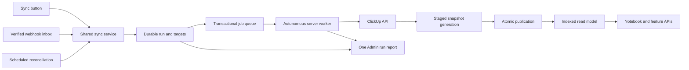

# ClickUp sync reliability review and implementation plan

Reviewed: 2026-10-14. Baseline: working changes against HEAD `0be48ce45d14c496556d6596dea9b26abb5ea17d`, including the new sync client helper. Implementation status: phases 1–3 and the daily-log portion of phases 4–5 are implemented in the current delivery. The original missing-date symptom was not reproduced; production confirmed 556 cached daily-log records and a 1,000-row Data API ceiling. The database now has durable run/target rows, claim fencing, staged generation publication, paginated snapshots, and a one-minute autonomous worker schedule.

The current changes consolidate refresh controls, but do not yet provide dependable completion, concurrency safety, complete historical reads, or trustworthy run reporting. Treat the browser-driven continuation as a temporary mechanism. The permanent design should make the server responsible for progressing a durable sync run, with the browser observing its progress.

The original missing-date symptom has not been reproduced against production data. Several mechanisms below can explain missing or stale logs; identifying which affected the user's logs is an explicit first deliverable.

**Standards and reliability review**

These five findings concern behavior, rather than a documented style violation. Some expose weaknesses in existing infrastructure that the new routes now exercise more often.

| Priority | Finding and evidence | Consequence |
| --- | --- | --- |
| P1 | Scheduled retries are included in failures, and failures override pending work in [clickupReadStore.ts:189](C:/Users/PRIME_Dave/Documents/project-echo-next/frontend/src/lib/clickupReadStore.ts:189). Continuation only runs for `state === "syncing"` in [Topbar.tsx:105](C:/Users/PRIME_Dave/Documents/project-echo-next/frontend/src/components/Topbar.tsx:105). | One delayed retry or terminal failure can stop unrelated healthy queued jobs from advancing. Closing the browser also removes this processing mechanism. The repository's fallback cron is daily. |
| P1 | Manual refresh calls invalidation, whose SQL changes even running jobs back to queued: [clickup_read_model.sql:132](C:/Users/PRIME_Dave/Documents/project-echo-next/supabase/clickup_read_model.sql:132). Publishing checks job state but not a unique claim token. Delta updates write rows before checking ownership: [clickupReadStore.ts:298](C:/Users/PRIME_Dave/Documents/project-echo-next/frontend/src/lib/clickupReadStore.ts:298). | Two workers can overlap. An older worker can publish over a newer result or change another attempt's state. Delta rows can be visible before the attempt completes. |
| P1 | Queue claims are global: [clickupReadStore.ts:202](C:/Users/PRIME_Dave/Documents/project-echo-next/frontend/src/lib/clickupReadStore.ts:202). The authenticated continuation returns processed list IDs and records telemetry as the requesting user: [sync/route.ts:38](C:/Users/PRIME_Dave/Documents/project-echo-next/frontend/src/app/api/integrations/clickup/sync/route.ts:38). | A user's request can process another connection's jobs and receive its list identifiers. Accounting can be attributed to the wrong user. Public run requests and privileged worker claims need separate authorization. |
| P1 | A job can fetch 30 pages: [clickupSync.ts:61](C:/Users/PRIME_Dave/Documents/project-echo-next/frontend/src/lib/clickupSync.ts:61). Individual fetches have no worker-supplied deadline, and 429 retries can sleep repeatedly: [clickupCalendarApi.ts:85](C:/Users/PRIME_Dave/Documents/project-echo-next/frontend/src/lib/clickupCalendarApi.ts:85). | A small job count does not guarantee completion within the route's 60-second limit. A crash restarts pagination and leaves work dependent on lease expiry and another worker invocation. |
| P2 | Continuation batches emit the same operation as initial requests, without a run ID; summaries count events as runs: [telemetry/route.ts:164](C:/Users/PRIME_Dave/Documents/project-echo-next/frontend/src/app/api/admin/telemetry/route.ts:164). | Request count, attempt count, completed runs, and elapsed run duration are mixed together. |

Five findings. The most serious standards/reliability issue is unsafe ownership of overlapping worker attempts.

**Requirements review**

| Priority | Missing or incorrect behavior | Evidence |
| --- | --- | --- |
| P1 | One failed target can prevent the rest of a requested refresh from completing. | The retry/status interaction above violates the centralized refresh requirement. |
| P1 | Manual refresh does not reliably repair deleted or moved-away records. After the first successful snapshot, the worker always uses a delta cursor. There is no implemented periodic full reconciliation. | [clickupSync.ts:57](C:/Users/PRIME_Dave/Documents/project-echo-next/frontend/src/lib/clickupSync.ts:57), [clickupReadStore.ts:291](C:/Users/PRIME_Dave/Documents/project-echo-next/frontend/src/lib/clickupReadStore.ts:291). |
| P1 | Automatic webhook provisioning was removed from read routes and was not relocated. Repository search finds `registerClickUpListWebhook` only at its definition. Existing production subscriptions may still exist; new target provisioning is not established in this code. | [clickupSync.ts:10](C:/Users/PRIME_Dave/Documents/project-echo-next/frontend/src/lib/clickupSync.ts:10). |
| P2 | Centralization is incomplete. Stale or absent snapshots still trigger ClickUp reads in feature GET routes; these reads do not publish a new authoritative snapshot or belong to a durable run. | [notebook/route.ts:41](C:/Users/PRIME_Dave/Documents/project-echo-next/frontend/src/app/api/notebook/route.ts:41); equivalent fallback patterns remain in tasks, My Day, demands, Forms tracking, and insights. |
| P2 | The report's pending count permanently sums historical queued observations. A later success does not remove those observations. Worker executions initiated by webhook or cron do not receive the same durable run accounting. | [telemetry/route.ts:169](C:/Users/PRIME_Dave/Documents/project-echo-next/frontend/src/app/api/admin/telemetry/route.ts:169). |

Five findings. The most serious requirements issue is that one Sync action does not guarantee independent completion of every target.

**Additional inherited risks to address during the migration**

- Snapshot retrieval is one `.limit(3001)` request without database pagination: [clickupReadStore.ts:271](C:/Users/PRIME_Dave/Documents/project-echo-next/frontend/src/lib/clickupReadStore.ts:271). Supabase projects have a configurable API row ceiling, documented as 1,000 by default. If production retains that ceiling, the code can accept 1,000 rows as a complete snapshot. The actual production setting and task counts are unverified. Missing monthly parents in a partial result can also cause valid daily subtasks to be filtered out.
- Both initial ClickUp ingestion and snapshot reads impose a 3,000-record ceiling. This makes accumulated daily-log history a foreseeable capacity issue. Increasing the number alone would move the failure threshold.
- The notebook projection relies on parsed names, inherited assignees, and UTC timestamp fallback. Those rules require fixtures for Manila dates, month boundaries, changed assignees, missing parents, and legacy naming. Its repeated scan for children at [notebook/route.ts:94](C:/Users/PRIME_Dave/Documents/project-echo-next/frontend/src/app/api/notebook/route.ts:94) also grows quadratically with history.
- Cache keys store full URL paths such as `/api/v2/list/...`, while selective invalidation uses `/list/...`: [clickupReadStore.ts:103](C:/Users/PRIME_Dave/Documents/project-echo-next/frontend/src/lib/clickupReadStore.ts:103). A scope-wide flush clears the current process's cache, but another process's in-memory cache can remain stale. In-flight responses can repopulate old data after invalidation.
- Shared database operations use a 1.2-second timeout, and some invalidation/failure RPC responses are not checked. A successful HTTP response must not imply that durable state was changed when persistence actually failed.
- Target discovery depends partly on browser local storage and silently truncates at 50 client IDs and 100 combined IDs. This cannot establish a complete, authoritative list of targets.
- Existing authorization needs a separate release gate: the user profile cookie is parsed JSON and is client-readable ([auth.ts:135](C:/Users/PRIME_Dave/Documents/project-echo-next/frontend/src/lib/auth.ts:135)); the Admin Telemetry route accepts `echo_admin_test=1` as an access bypass ([telemetry/route.ts:26](C:/Users/PRIME_Dave/Documents/project-echo-next/frontend/src/app/api/admin/telemetry/route.ts:26)). These behaviors predate this work. Server ownership and admin decisions must use verified identity, and test bypasses must be unavailable in production.

**Recommended target design**

Keep the existing Postgres integration storage and write outbox. Introduce one sync service that owns target discovery, run creation, queueing, execution policy, and status. Manual refresh, verified webhook events, scheduled reconciliation, and completed writes all call this service. Their HTTP entry points retain their appropriate authentication.

The public manual endpoint returns `202` with a durable `runId`. The browser reads authorized status for that run. A server scheduler invokes a protected worker independently of open tabs. Supabase Cron can invoke a bounded worker against the existing Postgres queue; verify the project's extension availability and scheduler configuration during implementation. An immediate best-effort wake can reduce latency, with the scheduler providing recovery.

A queue must tolerate repeat delivery. A visibility lease does not guarantee that an external ClickUp write happens exactly once. Preserve stable write request IDs, record remote IDs durably, and reconcile ambiguous create responses before retrying a create.

**Implementation sequence and acceptance gates**

1. **Establish the data baseline and contain correctness risks.** Trace known missing log dates from ClickUp response, through stored snapshot, parent/member/date projection, API payload, and browser filter. Compare exact counts, IDs, and page boundaries, including the production database row ceiling. Separate progress from health so an error never stops available work. Verify identity and run ownership. Add atomic enqueue and unique claim tokens before increasing worker concurrency. Gate: the missing-date cause is reproduced, and concurrency tests reject stale-worker writes.

2. **Make runs durable and workers autonomous.** Add `sync_runs`, run targets, and attempts, connected to the existing list jobs and write outbox. Store a stable connection identity independently of credential rotation. Coalesce repeated refresh requests for a connection/list, record a requested generation, and retain a follow-up request when a change arrives during an active attempt. An authenticated public API creates/reads owned runs; an internal worker claims jobs. Add independent scheduling, lease renewal/recovery, fairness between connections, and a visible terminal failure queue. Gate: sync completes after closing every browser tab; worker restarts and repeated clicks produce a correct final generation.

3. **Make snapshot publication complete and recoverable.** Fetch pages with explicit timeouts and an execution deadline. Persist page progress into a new generation; use a stable ordering and fixed delta watermark window, with overlap and ID deduplication. Validate response shapes before accepting an empty result. Advance the cursor and publish only after all pages succeed. Atomically publish records and generation metadata under the active claim token. Keep the last complete snapshot on any failure. Introduce periodic full reconciliation to detect missed deletes/moves and explicitly define normal incremental refresh versus repair reconciliation. Gate: partial pages never replace good data; datasets above 1,000 and 3,000 records remain complete; a missed deletion webhook is repaired.

4. **Unify feature reads and optimize date browsing.** All feature GET routes use the same read-model repository and freshness contract. A cold read requests bootstrap work through the sync service; pages show saved data with its actual sync time and current refresh state. Provision and monitor webhooks through the target registry, and record verified events durably before acknowledging delivery. Normalize notebook date, member identity, parent ID, and four existing category values without restructuring ClickUp's hierarchy. Index by connection/member/date; query the requested range and build child lookups once. Use snapshot generations to invalidate browser and server caches consistently. Gate: changing a date reads the local indexed model and produces no ClickUp request; stale/offline states retain useful historical logs.

5. **Build one truthful operational report.** Correlate run ID, target, attempt, trigger, worker claim, and API request. Obtain current pending and retry states from durable rows. Derive run success from published target generations, report partial completion explicitly, and keep retries distinct from terminal failures. Store target labels on the server. Aggregate historical metrics in SQL instead of loading a capped event array. Include data age, oldest queue age, duration, attempted/successful writes, record count, 429s, retries, last error, and reconciliation differences. Gate: the report for one click agrees exactly with persisted run state; a recovered job no longer appears currently pending.

6. **Roll out through measured failure tests.** Use additive migrations, retain the old complete snapshot, backfill the new read model, and compare task IDs and notebook fields before switching reads. Canary the daily log first, then move the other domains one at a time. Retire browser continuation and feature-specific ClickUp fallback loads after the new path passes its gates. Maintain a rollback flag for the read path and preserve pending writes across rollback.

**Remaining long-term work**

- Phase 4 is complete for the daily Notebook read. Other feature routes now use the read model where implemented, but verify there are no residual live ClickUp fallback paths before retiring every legacy path. Webhook provisioning and lifecycle monitoring still need operational verification.
- Phase 5 has durable run history, per-target state, and current queue counts in Admin Telemetry. SQL-side aggregation, duration/429/reconciliation metrics, and write attempt accounting remain future improvements.
- Phase 6 failure injection and measured rollout comparison remain. The user-visible missing-date case was not reproduced from a known date/record ID, so the exact original symptom remains unverified. Build and type checks are required for each release; run failure scenarios in staging before claiming the long-term gates are met.

**Required failure scenarios**

| Scenario | Required outcome |
| --- | --- |
| Two tabs click Sync; webhook arrives during ingestion | Coalesced work and a published generation that includes the later request; no lost update. |
| Worker dies between upstream response and database commit | Safe recovery; old complete snapshot remains visible; ambiguous creates are reconciled before another POST. |
| Expired worker returns after a new claim | Its claim token prevents any publication or state changes. |
| One target receives 429, 500, 401, or 403 | Header-aware delayed retry or explicit reconnect/access failure; healthy targets continue. |
| ClickUp reset lies beyond the worker deadline | Persist the next attempt time and release the worker; do not repeatedly retry before reset. |
| Database timeout or malformed upstream payload | Failure is recorded or safely recoverable; cursor and published generation do not advance. |
| More than 1,000 / 3,000 tasks; missing monthly parent; legacy date names | Complete database pagination, preserved hierarchy, and explicit projection diagnostics. |
| Duplicate/out-of-order webhook; missed delete/move | Idempotent inbox plus periodic full reconciliation converges to upstream state. |
| Browser closes; worker restarts; credentials rotate | Work continues independently; status remains accurate and scoped to verified ownership. |
| Queued target eventually succeeds | Current pending count becomes zero; one logical run retains all attempt history. |

Suggested initial operating targets, to validate against real list sizes and account limits: workers begin healthy queued work within 60 seconds; small incremental changes publish within two minutes under a healthy upstream; range reads have a p95 below 500 ms at the server; every acknowledged run remains discoverable; incomplete ingestion never replaces a complete snapshot. Full backfill duration must be estimated from measured page counts and token quota, not promised as a fixed short interval.

**Verification performed for this review**

- Full frontend TypeScript check passed: `tsc --noEmit --incremental false`.
- Existing `Topbar.test.tsx` and `mosaicWriteStore.test.ts` passed: two files, six tests. The initial sandbox attempt hit Windows package-resolution permissions; the local rerun passed.
- These tests cover recording controls and staged-record helpers. They do not exercise queue concurrency, webhook delivery, pagination, or the proposed run lifecycle.
- Production inspection confirmed the 1,000-row Data API cap, 556 cached daily-log records, 16 queued jobs, and the deployed migration/scheduler. One Cron invocation completed successfully. Webhook health and the original missing-date case remain unverified.

**Primary references**

- [ClickUp task listing](https://developer.clickup.com/reference/gettasks): 100 tasks per page, page indexing, timestamp filters, subtasks, closed tasks, and tasks in multiple lists. Configure these semantics per source and test them.
- [ClickUp rate limits](https://developer.clickup.com/docs/rate-limits): quotas are per token, with limit/remaining/reset response headers. Use a shared budget across workers and request paths.
- [ClickUp webhook health](https://developer.clickup.com/docs/webhookhealth): slow responses and failed deliveries affect webhook health; exhausted failed events are not replayed. A durable inbox and reconciliation are necessary for eventual repair.
- [Next.js after](https://nextjs.org/docs/app/api-reference/functions/after): post-response work is bounded by the route duration. It can wake/log work but cannot replace durable execution progress.
- [Supabase Cron](https://supabase.com/docs/guides/cron): server scheduling can invoke HTTP workers and records scheduled job outcomes.
- [Supabase Queues](https://supabase.com/docs/guides/queues): Postgres-backed durability and visibility windows are available if a standard queue primitive becomes preferable during implementation. The proposed first delivery can harden the existing queue tables.
- [Supabase query limits](https://supabase.com/docs/reference/python/select) and [JavaScript range pagination](https://supabase.com/docs/reference/javascript/range): the platform row ceiling is configurable; complete reads need explicit pagination or bounded indexed range queries.
